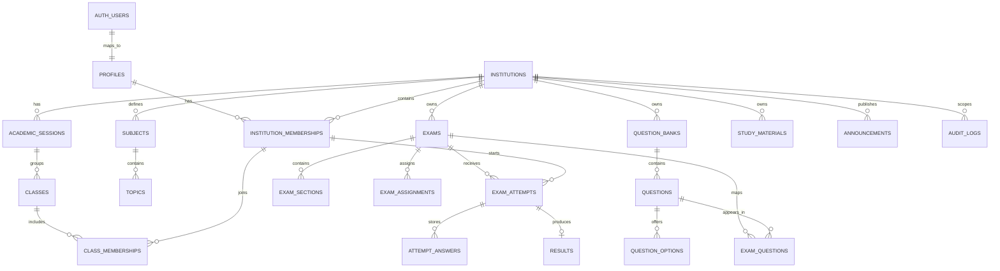

# Navark CBT — Multi-Institution Computer-Based Testing Platform

Navark CBT is a responsive, standalone frontend for a multi-institution Computer-Based Testing (CBT) platform. It provides role-specific portals for Platform Super Administrators, Institution Administrators, Teachers / Exam Managers, and Students, alongside a public website and examination player.

---

## 🎨 Brand Identity & Design System

- **Warm White (`#FFFBF5`)**: Main application backgrounds and light surfaces.
- **Maroon (`#481D1A`)**: Brand color, headings, primary buttons, and selected navigation.
- **Logo Asset**: Supplied `Navark MAIN LOGO NO BG.svg` located at `public/brand/navark-logo.svg`, displayed in proper aspect ratio with `object-contain`.
- **Typography & Icons**: Clean Inter sans-serif typeface paired with Lucide React iconography.

---

## 🏛️ Multi-Tenant Architecture & Roles

Identity is scoped by **Institution Code + User ID + Password**. The identical User ID can exist across different institutions without collision or cross-tenant data leakage:

| Role | Tenant Code | User ID | Persona Name | Key Duties |
|---|---|---|---|---|
| **Super Admin** | `GLOBAL` | `SA001` | Navark Platform Super Admin | Platform health, tenant approvals, user directory |
| **Inst. Admin** | `APEX` | `ADMIN` | Dr. Alok Verma | Apex students, faculty, batches, exam policies |
| **Inst. Admin** | `ZENITH` | `ADMIN` | Mrs. Rekha Banerjee | Zenith students, faculty, batches, exam policies |
| **Teacher** | `APEX` | `TCH101` | Prof. Rajesh Kulkarni (Physics) | Question bank authoring, exam creation, monitoring |
| **Teacher** | `ZENITH` | `TCH101` | Prof. Meera Sen (Math) | Advanced calculus questions, Olympiad exam series |
| **Student** | `APEX` | `STU001` | Aarav Sharma | Timed CBT attempt, instant scorecard, percentiles |
| **Student** | `ZENITH` | `STU001` | Rohan Verma | Timed CBT attempt, instant scorecard, percentiles |

---

## ⚡ Quick Start & Development

### 1. Requirements
- Node.js 18+ (tested on Node.js v26 LTS)
- npm or pnpm

### 2. Installation
```bash
npm install
```

### 3. Start Development Server
```bash
npm run dev
```
The server will start at `http://localhost:3000`.

### 4. Type Check & Production Build
```bash
npm run build
```

---

## 🚀 Interactive Demo Role & Tenant Switcher

A development-only floating widget is available in the bottom-right corner of every screen:
- Switch instantaneously between **Super Admin**, **Apex Admin**, **Zenith Admin**, **Apex Teacher**, **Zenith Teacher**, **Apex Student**, and **Zenith Student**.
- Switching institutions dynamically switches all visible cohorts, questions, exams, materials, and student rosters to verify multi-tenant isolation.
- Pre-fill one-click credentials on the Sign In page (`/login`).

---

## 📱 Complete Page Inventory

### A. Public Website
- `/`: Public Homepage with hero, feature cards, stakeholder journeys, and call-to-actions.
- `/features`: Categorized breakdown of CBT player, question bank, tenant management, and psychometrics.
- `/how-it-works`: Step-by-step onboarding journeys for institutions, educators, and candidates.
- `/about`: Product purpose, security philosophy, and platform overview.
- `/contact`: Validated institutional contact form with submission feedback.
- `/faq`: Searchable accordion addressing multi-tenancy and testing FAQs.

### B. Authentication & Onboarding
- `/login`: Institution Code + User ID + Password sign in with one-click demo presets.
- `/register`: Inbound institution onboarding application with compliance notice.
- `/forgot-password`: Identifier-based recovery request flow.
- `/reset-password`: Token password update with strength rules.
- `/accept-invitation`: Institutional invitation activation flow.
- `/unauthorized`: Guard screen for unauthorized role access.

### C. Platform Super Admin
- `/super-admin`: Telemetry overview, exam throughput graphs, tenant stats.
- `/super-admin/institutions`: Searchable/filterable list with suspend/reactivate toggles.
- `/super-admin/institutions/new`: Tenant provisioning wizard.
- `/super-admin/institutions/:institutionId`: Detailed tenant inspector with cohort tabs.
- `/super-admin/requests`: Inbound onboarding review with approve/reject dialogs.
- `/super-admin/users`: Global user directory with role and tenant filters.
- `/super-admin/analytics`: Multi-tenant exam volume trends and question distributions.
- `/super-admin/settings`: Global timeout, branding preview, and security policies.

### D. Institution Admin
- `/institution`: Campus overview with live exam monitors and recent results.
- `/institution/profile`: Tenant address, code, and administrative details.
- `/institution/students`: Student enrollment directory and batch filters.
- `/institution/students/new` & `/:id/edit`: Student enrollment form with duplicate ID validation.
- `/institution/students/:id`: Candidate profile with test history.
- `/institution/teachers`: Faculty directory and specializations.
- `/institution/teachers/new` & `/:id/edit`: Educator account creation and editing.
- `/institution/teachers/:id`: Faculty profile and authored exams.
- `/institution/batches`: Class cohorts and academic year management.
- `/institution/subjects`: Syllabus catalog and question bank taxonomy.
- `/institution/questions`: Question library with subject, difficulty, and type filters.
- `/institution/questions/new` & `/:id/edit`: Problem authoring editor (MCQ, Multi-Correct, Numerical).
- `/institution/questions/:id`: Candidate-mode preview with staff answer key toggle.
- `/institution/questions/import`: Bulk CSV question ingestion wizard with preview.
- `/institution/exams`: Test series listing with status filters.
- `/institution/exams/new` & `/:id/edit`: Exam builder with question selector and rules.
- `/institution/exams/:examId`: Exam monitor with question and submission tabs.
- `/institution/results`: Institutional gradebook with CSV export.
- `/institution/analytics`: Batch performance and topic-level accuracy curves.
- `/institution/materials`: Handout upload and distribution.
- `/institution/announcements`: Campus bulletin broadcaster.
- `/institution/settings`: Default exam timers, negative marking penalties, and policies.

### E. Teacher / Exam Manager
- `/teacher`: Faculty dashboard with assigned batch KPIs.
- `/teacher/batches`: Assigned cohorts and student counts.
- `/teacher/students`: Cohort student directory.
- `/teacher/questions`: Authored problems and repository editor.
- `/teacher/exams`: Test management for assigned classes.
- `/teacher/exams/:examId`: Submission monitoring and progress counters.
- `/teacher/results`: Cohort test performance.
- `/teacher/analytics`: Subject accuracy vectors and difficulty curves.
- `/teacher/materials`: Handouts and formula sheet publisher.
- `/teacher/settings`: Educator profile and contact preferences.

### F. Student Experience & CBT Examination Player
- `/student`: Candidate dashboard with live exam alerts and performance stats.
- `/student/profile`: Enrolled student profile and roll number.
- `/student/exams`: Live, Upcoming, and Completed test tabs.
- `/student/exams/upcoming`: Calendar list of scheduled examinations.
- `/student/exams/:examId/instructions`: Official instructions, marking scheme, rules, and start gate.
- `/student/exams/:examId/attempt`: **CBT Examination Arena**
  - Responsive, distraction-free environment.
  - Server countdown clock with low-time warning.
  - 5-state interactive question palette (Not Visited, Not Answered, Answered, Marked for Review, Answered & Marked).
  - Clear response, Save & Next, and Mark for Review & Next controls.
  - Simulated heartbeat background autosave.
  - Final submission dialog with answered vs unanswered summary.
- `/student/exams/:examId/submitted`: Submission receipt with timestamps.
- `/student/results`: Candidate scorecards with rank, accuracy, and date.
- `/student/results/:resultId`: Detailed breakdown with sectional scores.
- `/student/performance`: Percentile curves and subject mastery strengths.
- `/student/materials`: Assigned reading sheets and syllabus files.
- `/student/announcements`: Bulletins from faculty and administration.

### G. Shared System Pages
- `/notifications`: Role-scoped notifications with unread badges.
- `/help`: Candidate FAQ accordion and support ticket submission form.
- `/settings`: Account preferences and contact editing.
- `/settings/change-password`: Secure password change dialog.
- `/search`: Multi-category portal search across exams, questions, cohorts, and handouts.
- `*`: Branded 404 Not Found page.
- `/service-unavailable`: Platform maintenance and retry screen.

---

## 🔒 Security Architecture
- Real multi-tenant data boundaries, exam eligibility, timing verification, and result publication must be enforced on backend services.
- User IDs are scoped within `institution_id` in database schemas.
- Plaintext passwords or secrets are never persisted in client-side code or browser storage.

# NavarK CBT — Database Architecture

**Version:** 1.0  
**Status:** Extracted from the finalized Phase 1 baseline  
**Date:** 2 November 2026  
**Database:** Supabase PostgreSQL  
**Application architecture:** Modular Monolith · Multi-Tenant SaaS

> This document isolates the database architecture for NavarK CBT from the master documentation. It preserves the approved Phase 1 decisions and marks unresolved product rules as items requiring confirmation. This is a logical architecture specification, not executable production SQL.

## 1. Purpose and architectural decisions

NavarK CBT uses **one Supabase PostgreSQL database** shared by one Next.js application. Database responsibilities are separated by logical module ownership, not by separate databases or microservices.

- One physical PostgreSQL database for Phase 1.
- Each module owns its tables, migrations, validation, and data-access functions.
- Other modules use the owning module’s exported service or contract rather than directly changing its tables.
- Use UUID primary keys, `timestamptz` for timestamps, explicit status enums or constrained text values, and `created_at` / `updated_at` fields where appropriate.
- Use foreign keys, constraints, indexes, transactions, and PostgreSQL Row Level Security (RLS) to protect data integrity and tenant isolation.
- The server is authoritative for tenant access, exam timing, attempt state, submission, and scoring.
- Do not introduce multiple databases or microservices in Phase 1.

### Canonical names

Use these names consistently in the database and APIs:

- `institutions`
- `institution_memberships`
- `institution_id`
- `institution_code`
- `exams`
- `exam_sections`
- `exam_questions`
- `exam_assignments`
- `exam_attempts`
- `attempt_answers`
- `audit_logs`
- `classes`
- `class_memberships`

Do not substitute `tests`, `attempts`, `test_questions`, or `batches` as synonyms in the canonical schema.

## 2. Database module ownership

| Module | Tables / responsibilities | Primary owner |
|---|---|---|
| Identity & Access | `profiles`, authentication mapping, identity metadata, role assignments | Developer 3 |
| Institutions | `institutions`, `institution_memberships`, institution settings, academic sessions, classes, class memberships | Developer 1, with platform review |
| Questions | `question_banks`, `questions`, `question_options`, `docx_import_jobs` | Developer 1 |
| Exams | `exams`, `exam_sections`, `exam_questions`, `exam_assignments`, `exam_attempts`, `attempt_answers` | Developer 2 |
| Results | Result summaries, scoring outputs, release state, analytics aggregates | Developer 2 |
| Platform | `audit_logs`, shared tenant utilities, operational metadata | Developer 3 |

A module boundary is an ownership rule, not necessarily a separate PostgreSQL schema. Begin with clear table ownership and migration folders. Introduce separate PostgreSQL schemas only if they provide real value and permissions/migrations can be managed correctly.

## 3. Multi-tenant data model

Each coaching institution is a tenant. Every institution-owned record must have a direct `institution_id` or a rigorously enforced ownership path through a parent record.

A user's permitted institution and role must be derived from the authenticated identity and trusted membership records. Never trust a client-supplied `institution_id`, role, student ID, or other identifier as proof of authorization.

### Core identity and tenant tables

#### `institutions`

Purpose: Represents each coaching institution.

Core fields:
- `id` UUID, primary key
- `institution_code`, unique
- `name`
- `status` — constrained to values such as `pending`, `active`, `suspended`
- `timezone`
- `logo_path`, where applicable
- `settings` JSONB
- `created_at`, `updated_at`

Constraints:
- Primary key on `id`
- Unique constraint on `institution_code`
- Constrained status values

#### `profiles`

Purpose: Application profile mapped to Supabase Auth.

Core fields:
- `id` UUID, primary key
- `auth_user_id` UUID, unique, referencing `auth.users(id)`
- `display_name`
- `email`, nullable if not required
- `phone`, nullable if not required
- `status`, where applicable
- `created_at`, `updated_at`

Do not store plaintext passwords or custom password hashes in application tables.

#### `institution_memberships`

Purpose: Connects a profile to an institution and defines the user's institution-specific login code, role, and status.

Core fields:
- `id` UUID, primary key
- `institution_id`
- `profile_id`
- `user_code` / `login_id` (confirm the final field name before migration)
- `role`
- `status`
- `created_at`, `updated_at`

Constraints:
- Foreign keys to `institutions` and `profiles`
- Unique `(institution_id, user_code)` or `(institution_id, login_id)`, depending on the final field name
- Unique `(institution_id, profile_id)` unless multiple identities per tenant are explicitly supported

The same user code may be used by different institutions if institution-scoped uniqueness is retained.

## 4. Logical schema inventory

The following is the Phase 1 logical starting model. Confirm exact field types, deletion behavior, and indexes during implementation.

| Table | Core fields / purpose |
|---|---|
| `institutions` | `id`, `institution_code`, `name`, `status`, `timezone`, `settings`, timestamps |
| `profiles` | `id`, `auth_user_id`, `display_name` / full name, optional email and phone, status, timestamps |
| `institution_memberships` | `id`, `institution_id`, `profile_id`, user/login code, role, status |
| `academic_sessions` | `id`, `institution_id`, `name`, `start_date`, `end_date`, `status` |
| `classes` | `id`, `institution_id`, `academic_session_id`, `name`, `status` |
| `class_memberships` | `id`, `institution_id`, `class_id`, `institution_membership_id` / student membership, `status`, `joined_at` |
| `subjects` | `id`, `institution_id`, `name`, `code`, `status` |
| `topics` | `id`, `institution_id`, `subject_id`, nullable `parent_topic_id`, `name` |
| `question_banks` | `id`, `institution_id`, `title`, optional `subject_id`, `owner_membership_id`, `status` |
| `questions` | `id`, `institution_id`, `question_bank_id`, optional subject/topic IDs, `type`, `prompt`, `difficulty`, `marks`, `negative_marks`, optional `explanation`, `status` |
| `question_options` | `id`, `institution_id`, `question_id`, `option_key`, `content`, `is_correct`, `display_order` |
| `docx_import_jobs` | `id`, `institution_id`, `uploaded_by`, `storage_path`, `status`, optional `error_summary`, `created_at`, optional `completed_at` |
| `exams` | `id`, `institution_id`, `title`, optional description/subject, `duration_minutes`, `starts_at`, `ends_at`, `total_marks`, negative-marking setting, instructions, status, `created_by` |
| `exam_sections` | `id`, `institution_id`, `exam_id`, `title`, `display_order`, `marks` |
| `exam_questions` | `id`, `institution_id`, `exam_id`, `question_id`, optional `section_id`, `display_order`, optional marks and negative-marks overrides |
| `exam_assignments` | `id`, `institution_id`, `exam_id`, optional `class_id` or `student_membership_id`, `available_from`, `available_until` |
| `exam_attempts` | `id`, `institution_id`, `exam_id`, `student_membership_id`, `status`, `started_at`, `deadline_at`, optional `submitted_at`, evaluation status |
| `attempt_answers` | `id`, `institution_id`, `exam_attempt_id`, `question_id`, `answer_payload` JSONB, `marked_for_review`, `saved_at`, `version` |
| `results` | `id`, `institution_id`, `exam_attempt_id`, `score`, `max_score`, correct/wrong/unanswered counts, time taken, evaluation version, optional `released_at` |
| `study_materials` | `id`, `institution_id`, `title`, optional description, `storage_path`, `uploaded_by`, `visibility`, `status`, `created_at` |
| `announcements` | `id`, `institution_id`, `title`, `body`, `audience`, optional publish/expiry timestamps, `created_by`, `status` |
| `audit_logs` | `id`, nullable `institution_id`, nullable `actor_profile_id`, `action`, `entity_type`, optional `entity_id`, metadata JSONB, `created_at` |

**Schema note:** The master specification lists some academic tables more than once in its initial inventory and detailed column section. This document consolidates them into one logical entry per table; it does not define production migrations.

## 5. Entity relationships



Relationship summary:
- `auth.users` to `profiles`: 1:1
- `profiles` to `institution_memberships`: 1:N
- `institutions` to `institution_memberships`: 1:N
- `academic_sessions` to `classes`: 1:N
- `classes` to memberships: N:M through `class_memberships`
- `question_banks` to `questions`: 1:N
- `questions` to `question_options`: 1:N
- `exams` to `questions`: N:M through `exam_questions`
- `exam_attempts` to `attempt_answers`: 1:N
- `exam_attempts` to `results`: 1:0..1

## 6. Data integrity and constraints

Apply database-level integrity controls in addition to application validation.

- Use foreign keys and `NOT NULL` constraints for required relationships.
- Prevent duplicate membership codes within an institution.
- Use composite uniqueness such as `UNIQUE(institution_id, id)` on parent tables where needed, then composite foreign keys `(institution_id, parent_id)` to enforce same-tenant relationships.
- Ensure an exam, its student, its assignment, and its attempt belong to the same institution.
- Ensure an answer's question belongs to the exam associated with the attempt.
- Ensure question banks, subjects, topics, questions, sections, and exam-question mappings cannot cross tenant boundaries.
- Enforce marks and negative marks as non-negative.
- Ensure exam duration is positive and schedule values are valid.
- Prevent duplicate question ordering within an exam or section where applicable.
- Use `UNIQUE(exam_attempt_id, question_id)` for `attempt_answers`.
- Use `UNIQUE(exam_attempt_id)` for `results`.
- Use `UNIQUE(exam_id, display_order)` for exam sections and exam-question ordering where specified.
- Ensure an exam assignment has at least one target (class or student).
- Use transactions for operations that must succeed or fail together, such as creating an attempt and reserving its state.
- Define deletion policies carefully; prefer archival/soft deletion for academic records and audit history.

## 7. Indexing starting points

Create and validate indexes based on query patterns and measured performance. Initial candidates from the baseline:

- Unique index on `institutions(institution_code)`.
- Unique index on `institution_memberships(institution_id, user_code)` (or the confirmed `login_id` field).
- Index on `institution_memberships(profile_id, institution_id)`.
- Index on `question_banks(institution_id, status)`.
- Index on `questions(institution_id, question_bank_id, status)`.
- Index on `exams(institution_id, status, starts_at)`.
- Index on `exam_assignments(institution_id, exam_id, class_id)`.
- Index on `exam_attempts(institution_id, student_membership_id, started_at)`.
- Index on `exam_attempts(exam_id, status)`.
- Unique index on `attempt_answers(exam_attempt_id, question_id)`.

## 8. Row Level Security (RLS) and authorization

Enable RLS on every private tenant-owned table, including join tables. Review storage metadata and Supabase Storage policies as well.

Mandatory rules:
1. Resolve the current profile and active institution membership from the verified session.
2. Never trust `institution_id` from a request body or browser state.
3. Apply server-side authorization to every read, write, search, report, export, and file operation.
4. Cover `SELECT`, `INSERT`, `UPDATE`, and `DELETE` separately in RLS policies where permissions differ.
5. Students may access only their permitted assignments, attempts, answers, released results, study materials, and announcements.
6. Teachers are limited to assigned classes and authorized exams.
7. Institution Admins are limited to their own institution.
8. Platform Super Admin access to institution academic data must be explicit, narrowly scoped, and audited; do not grant broad automatic access.
9. Review `SECURITY DEFINER` functions, views, triggers, service-role operations, and storage policies for RLS bypass paths.
10. Keep the Supabase service-role key server-only and use the least-privileged database access possible.

RLS is not a replacement for application authorization, and application authorization is not a replacement for RLS. Use both and test them.

## 9. Authentication and database identity mapping

The login screen uses Institution Code, User ID, and Password. The server must:

1. Normalize and resolve the institution code, rejecting unknown or inactive institutions.
2. Resolve the user identity within that institution.
3. Authenticate credentials through Supabase Auth using a secure server-side mapping strategy.
4. Verify account status, active membership, and role from trusted database records.
5. Create or refresh a secure session and return only safe profile information.
6. Redirect according to the role resolved by the server.

User codes are generated by trusted backend logic where uniqueness and auditability depend on them. Passwords are handled by the authentication provider; application tables must never store plaintext passwords or custom password hashes. Login must use rate limits, generic error messages, and audit logging without revealing whether a particular user code exists.

## 10. Exam data lifecycle requirements

The database design must support server-authoritative exam behavior.

### Attempt lifecycle

```text
not_started -> in_progress -> submitted
                         |-> auto_submitted
                         |-> expired
```

- Generate `started_at` and `deadline_at` on the server.
- Validate publication status, assignment, availability window, attempt limit, and existing attempt state before starting.
- Create attempts transactionally and make start/resume behavior idempotent where appropriate.
- Save answers through authenticated, attempt-bound operations.
- Validate that an attempt is `in_progress` and that each answered question belongs to that exam.
- Use upsert or version-aware writes so retries do not create duplicate answer rows.
- Treat submission as a server-side state transition and make it idempotent.
- Persist the final answer snapshot before scoring.
- Calculate scores on the server using trusted answer keys; never trust marks or correctness values from the browser.
- Auto-submit or expire attempts when the server determines the deadline has passed.
- Store a result summary separately from individual answers.
- Enforce result release permissions; students cannot see unreleased results.
- Record attempt, scoring, and result-release events in `audit_logs`.

## 11. DOCX import and file storage metadata

Phase 1 supports Word `.docx` question import with preview and human approval. PDF-to-question import is out of scope.

`docx_import_jobs` tracks the import lifecycle. Expected statuses include:
- `uploaded`
- `processing`
- `needs_review`
- `approved`
- `failed`

Workflow:
1. Validate file extension, MIME type, size, and institution permission.
2. Store the document in a private Supabase Storage bucket.
3. Create the import job and record the storage path and uploader.
4. Parse supported DOCX structures into a draft representation.
5. Present detected questions, options, marks, answer keys (if present), and warnings.
6. Require teacher correction and approval before persisting final questions.
7. Save approved questions/options in a transaction and update the job status.

Do not execute macros or embedded scripts. Validate archive contents, enforce upload size limits and parsing timeouts, sanitize rendered content, and do not infer correct answers when the source does not provide them. Use private storage buckets and short-lived signed URLs for protected files.

## 12. Audit and privacy

`audit_logs` is the canonical audit table. It may have a nullable `institution_id` for platform-level events.

Minimum events to record:
- Login success/failure and logout.
- Account activation, suspension, and role changes.
- Institution creation and configuration changes.
- Question import approval and question edits.
- Exam creation, publishing, cancellation, and assignment changes.
- Attempt start, submit, auto-submit, and result release.
- Administrative exports and privileged access.

Keep audit history append-only for ordinary application roles. Do not log passwords, tokens, or sensitive answer content unnecessarily. Collect only student data required for the service and define access, retention, backup, restore, and incident-response rules before production.

## 13. Migration and change management

- Each module owner creates uniquely named, version-controlled migrations for owned tables.
- Developer 3 coordinates shared migration conventions and reviews RLS, foreign keys, naming, and shared impact.
- Test migrations against local/staging databases and review rollback/recovery strategy.
- Merge migrations through pull requests and deploy them in a controlled release step.
- Do not let multiple developers edit the same migration file.
- Never let individual developers or coding agents silently alter schema decisions.
- Update shared contracts and record confirmed decisions in `docs/decisions/`.

## 14. Database testing and acceptance criteria

### Required tests

- Unit tests for validation, scoring rules, attempt state transitions, permission helpers, and DOCX parser edge cases.
- Integration tests for API/database behavior, transactions, attempt creation, answer upserts, and idempotent submission.
- RLS/security tests proving cross-institution reads and writes are denied.
- Tests proving altered institution IDs are ignored and guessed IDs do not expose another tenant's data.
- Reliability tests for refresh/reconnect during an exam, duplicate requests, delayed autosave, deadline expiry, and session expiry.
- End-to-end journey: institution onboarding → user creation → question bank → DOCX review/approval → exam publishing/assignment → student attempt → result release.

### Definition of done

- Database constraints and migrations are reviewed.
- Server authorization and tenant isolation are implemented.
- RLS policies are tested for all relevant operations.
- Cross-institution denial and exam recovery tests pass.
- Scoring reconciles against known test cases.
- Backup and recovery procedures are defined before production.
- No secrets or real personal data are committed.

## 15. Open decisions requiring confirmation

The following decisions are not fully settled in the source baseline and must be confirmed before production migrations:

- Whether one profile may actively belong to multiple institutions.
- Whether students can belong to multiple classes.
- Final membership login field name: `user_code` or `login_id`.
- Whether additional roles, such as evaluator, are required.
- Whether a separate coaching-batch concept is needed in addition to `classes`.
- Initial question types beyond single-correct MCQ, including multiple-select and true/false.
- Attempt limits, late-entry policy, resume policy, negative-marking rules, answer review, and result-release policy.
- DOCX file-size limit and supported formatting subset.
- Hosting region, data-retention period, backup frequency, and production support owner.

## 16. Implementation note

This document is the extracted **Phase 1 logical database architecture**. It is not an executable SQL migration. Convert it into ordered migrations only after confirming open product rules, exact constraints, deletion behavior, RLS policies, and required indexes. Keep the master architecture documentation as the source of truth and update this document through reviewed changes.
